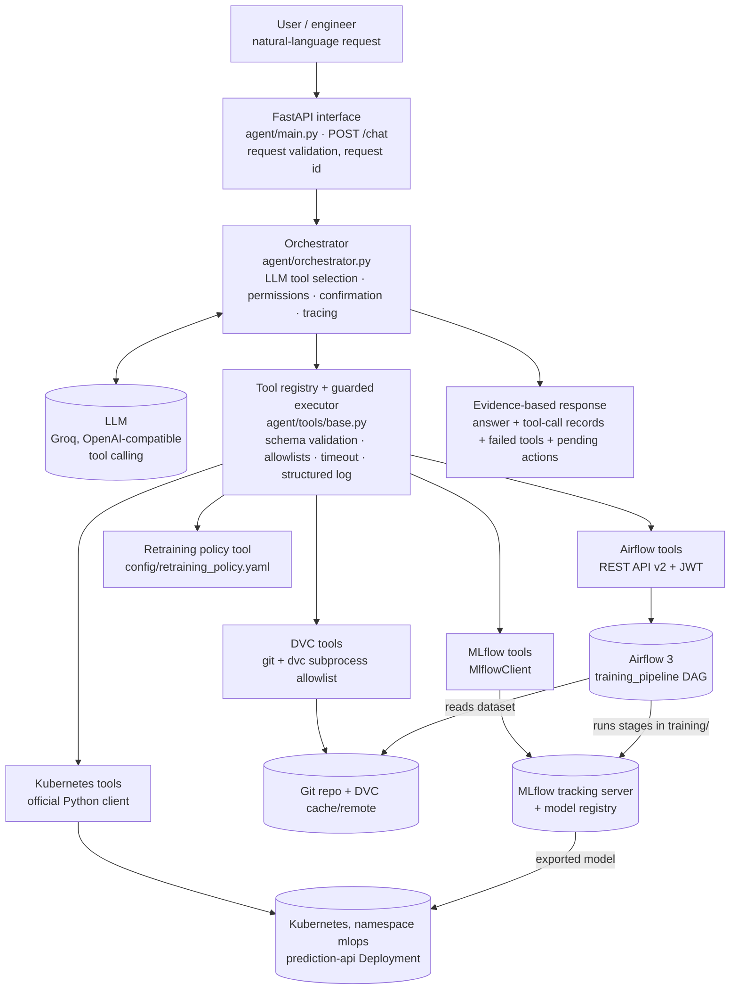

# Architecture

## 1. Overview



The agent never answers operational questions from the model's own knowledge. The LLM only
chooses which tools to call and words the final answer; every fact comes from a tool result,
and the raw tool results are returned to the caller next to the answer.

## 2. Components

| Component | File | Responsibility |
|---|---|---|
| HTTP interface | `agent/main.py` | `POST /chat`, `GET /tools`, `GET /health`. Validates requests with Pydantic (`extra="forbid"`, length and pattern limits). |
| Terminal interface | `agent/cli.py` | Same orchestrator without a server; asks `y/N` for pending actions; can write transcripts. |
| Orchestrator | `agent/orchestrator.py` | Agent loop (max 12 steps), per-session history, pending-action store, runtime notices. |
| LLM client | `agent/llm.py` | Thin interface over an OpenAI-compatible chat-completions API (`openai/gpt-oss-120b` on Groq), with fallback keys on HTTP 429. Tests swap in a scripted model. |
| Registry / executor | `agent/tools/base.py` | Validates arguments, runs prechecks, enforces confirmation and timeouts, maps exceptions to statuses, writes one structured log line per call. |
| Tool modules | `agent/tools/*.py` | 30 tools: DVC 6, MLflow 7, Airflow 7, Kubernetes 9, policy 1. |
| Training stages | `training/*.py` | validate → preprocess → train → evaluate → quality gate → register. Each is a CLI module. |
| DAG | `dags/training_pipeline.py` | Airflow 3 TaskFlow DAG that runs the stages with retries and gating. |
| Inference service | `api/main.py`, `Dockerfile`, `kubernetes/` | FastAPI prediction API, 2 replicas, probes, limits, ConfigMap, ClusterIP Service. |

## 3. Request flow

1. `POST /chat` is validated and given a request id (or the caller's `X-Request-ID`).
2. The orchestrator sends the system prompt, the session's previous question/answer text and
   the 30 tool schemas to the LLM.
3. For each tool call the LLM returns, the executor:
   validates the arguments against the tool's Pydantic model → runs the tool's permission
   precheck → (state-changing tools stop here and become a *pending action*) → runs the tool
   in a worker thread with a time budget → converts the outcome into a `ToolResult` with one
   of the statuses `ok | error | unavailable | timeout | invalid_input | denied |
   confirmation_required`.
4. Tool results go back to the LLM as JSON. A non-`ok` result carries **no data**, only the
   error and an instruction not to guess.
5. When the LLM stops calling tools, its text becomes the answer. The runtime then appends,
   independently of the LLM, a *tool availability notice* for every failed call and a list of
   actions awaiting confirmation.
6. Two runtime guards act on the LLM's draft: tool results are shrunk to a per-turn context
   budget (the free LLM tier accepts 8,000 tokens per request), and an answer that used
   `evaluate_retraining_need` is sent back once if DVC, MLflow, Airflow DAG runs or Kubernetes
   were not all queried.
7. The response contains the answer, every tool call with arguments, status, duration and
   result, the failed tools and the pending actions.

## 4. How data provenance links the four systems

```
git tag data-v2.0 ──► data/raw/dataset.csv.dvc (md5) ──► DVC cache / remote (the bytes)
                                   │
        training/train.py reads the pointer + hashes the file actually used
                                   ▼
MLflow run tags: dvc.md5, dvc.dataset_version, dvc.pointer_commit, git.commit,
                 dvc.workspace_matches_pointer, airflow.dag_run_id, quality_gate
                                   ▼
MLflow model version tags (dvc.md5, dvc.dataset_version) ──► serving_model/model_meta.json
                                   ▼
        prediction-api `/version` in Kubernetes reports run id + dataset version
```

So "which dataset trained the model that is deployed?" is answered by reading recorded
values end to end: Kubernetes `/version` → MLflow run → DVC md5 → git tag. `dvc_find_version`
then confirms that md5 really exists in the repository history.

## 5. Tool choices and why

| Decision | Reason |
|---|---|
| **DVC through `subprocess` with an allowlist** | The assignment allows subprocess; an explicit `(binary, sub-command)` allowlist with `shell=False` and validated revisions is easy to audit. Only read-only commands are approved. Old versions are fetched with `dvc get` into a temp directory, so the agent can prove a version is reproducible without touching the workspace. |
| **`MlflowClient`** | Required by the assignment; typed access to runs, metrics and the registry. Retries are reduced so an outage is reported in seconds rather than minutes. |
| **Airflow REST API v2 with JWT** | Airflow 3 removed the old `/api/v1` and basic auth; the agent logs in at `/auth/token` and sends a Bearer token, re-authenticating once on HTTP 401. |
| **Official `kubernetes` Python client** | Structured objects instead of parsing `kubectl` text; per-request timeouts; no shell. |
| **Direct tool calling instead of an agent framework** | The loop is ~150 lines, so every safety property (confirmation, allowlists, notices) is in code that can be read and unit-tested, with no framework behaviour to trust. |
| **Groq via the OpenAI-compatible API** | Free tier with native tool calling. Because only the base URL, key and model name are configured, any OpenAI-compatible provider can be substituted. |
| **Separate virtualenv for Airflow** | Airflow pins hundreds of dependencies. The DAG runs each stage with the project interpreter (`.venv/bin/python -m training.<stage>`), so ML libraries never have to satisfy Airflow's constraints. |
| **Model baked into the image** | The Pod has no runtime dependency on the MLflow server, so serving survives a tracking-server outage. `model_meta.json` keeps the link back to the MLflow run and dataset. |
| **kind** | Single Docker container, lowest memory footprint for a 2-replica deployment on a laptop. |

## 6. Safety model

| Risk | Control | Where |
|---|---|---|
| LLM invents results when a system is down | Non-`ok` results carry no data; runtime appends a notice the LLM cannot remove; raw evidence is returned | `schemas.ToolResult.for_llm`, `Orchestrator._finish` |
| LLM changes cluster state on its own | State-changing tools are never executed from an LLM call. They become a pending action that only a later request carrying `confirm_action_id` can execute. Single use, session-bound, expires after 10 minutes | `Orchestrator._dispatch`, `_chat` |
| LLM tries to approve itself | Tool inputs forbid unknown fields, so `confirm=true` is a validation error; the `confirmed` flag lives in `ToolContext`, which the LLM cannot write | `schemas.ToolArgs`, `base.ToolContext` |
| Access outside the application | Every Kubernetes tool, read or write, is confined to one namespace; mutations only on approved Deployments, replicas capped | `kubernetes_tools.approved_namespace`, `check_mutation_allowed` |
| Arbitrary pipelines started | Only DAG ids in `AIRFLOW_APPROVED_DAGS`; conf limited to four typed fields | `airflow_tools.TriggerArgs`, `check_trigger_allowed` |
| Retraining started from a question | Trigger requires confirmation; `evaluate_retraining_need` is read-only and recommends only on documented policy rules | `policy_tools.py`, `config/retraining_policy.yaml` |
| Command injection | No shell anywhere; command allowlist; regex-validated revisions, DAG ids and pod names | `dvc_tools._run`, argument models |
| A tool hangs | Per-tool time budget in the executor plus network timeouts in each client | `ToolRegistry.execute` |
| Secrets leak | Secrets only from environment / `.env` (git-ignored), held as `SecretStr`; log formatter redacts secret-looking keys and token patterns | `config.py`, `logging_utils.py` |
| Bad model promoted | `register_model` is downstream of `quality_gate`, and re-checks the gate tag itself | `dags/training_pipeline.py`, `training/register.py` |

`kubernetes/rbac.yaml` additionally defines a least-privilege ServiceAccount/Role (get/list on
workloads, patch on Deployments, nothing else) for running the agent with restricted
credentials instead of an admin kubeconfig.

## 7. Structured logging

One JSON line per event on stderr, for example:

```json
{"ts": "2026-11-13T20:14:03+0500", "level": "INFO", "logger": "mlops_agent.tools",
 "event": "tool_call", "request_id": "9f2c…", "tool": "k8s_unhealthy_pods",
 "category": "kubernetes", "status": "ok", "duration_ms": 41.3, "mutating": false,
 "confirmed": false, "arguments": {}, "error": null}
```

`request_started` and `request_finished` events carry the same `request_id`, so all tool
calls of one conversation turn can be correlated.
